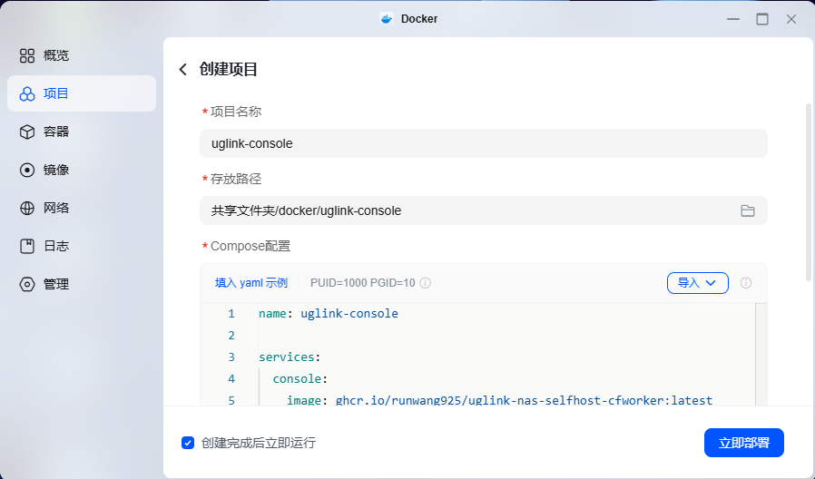
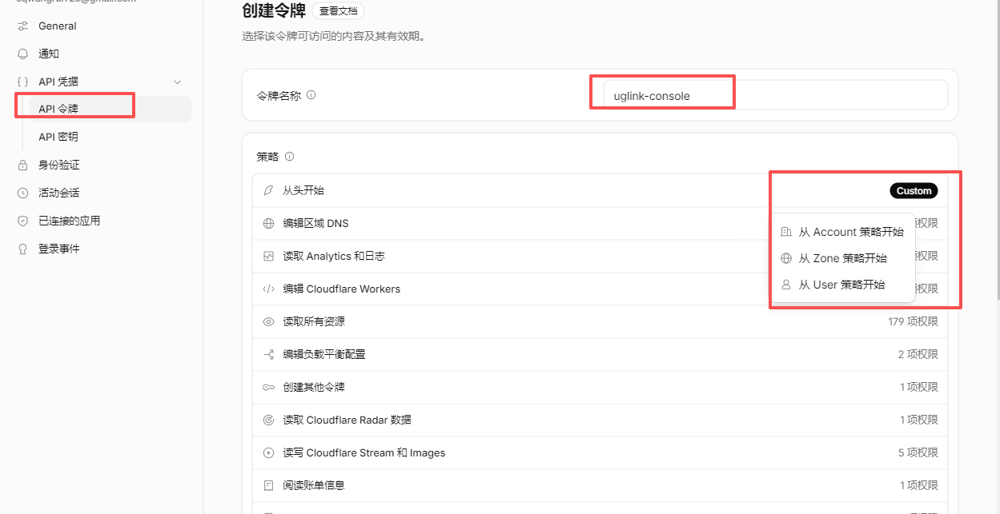
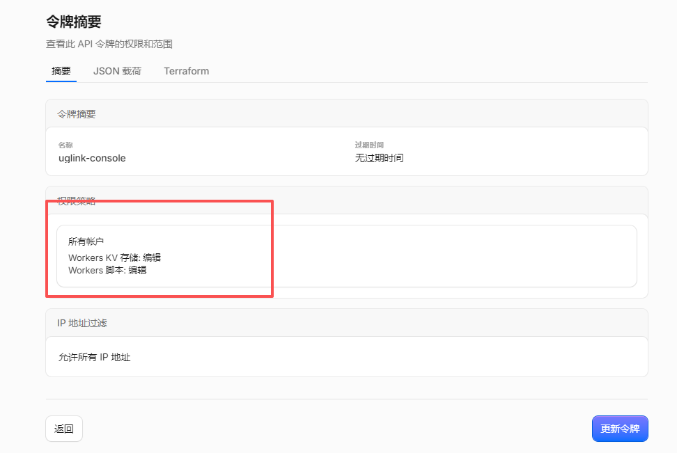
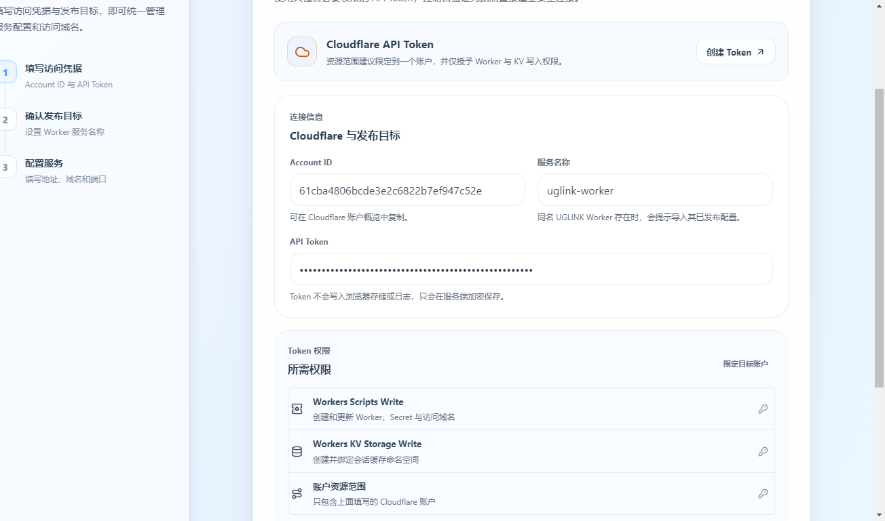
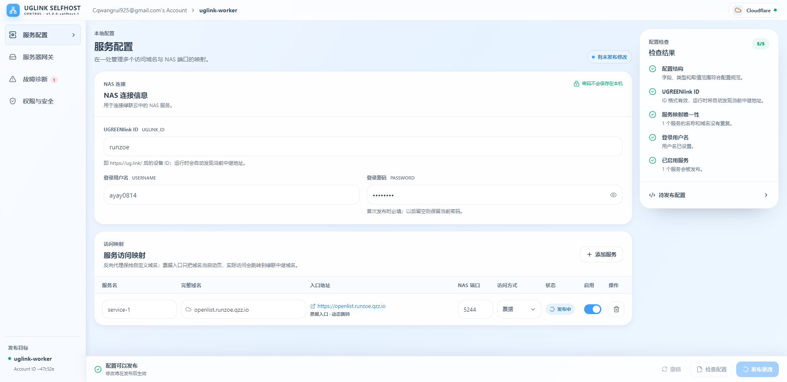

# SELFHOST 版 NAS 部署指南

本指南适用于 UGREEN（绿联）NAS 的 Docker「项目」功能。部署完成后，NAS 上的控制台是**唯一配置入口**，可同时管理 Cloudflare 网关和自建服务器网关。

## 0. 先认清三个名字

| 名称 | 位置 | 作用 |
|---|---|---|
| `uglink-console` | NAS Docker 容器 | 统一控制台（唯一配置入口） |
| `uglink-gateway-cf` | Cloudflare Worker | CF 网关（旧部署可能叫 `uglink-worker`） |
| `uglink-gateway-server` | 你的云服务器容器 | 自建网关（管理端口 9090） |

访问方式组合（四格矩阵）：

| 网关 \ 模式 | 代理（proxy） | 票据（ticket） |
|---|---|---|
| CF 网关 | Worker 全量转发，占 CF 流量 | 只发一次性票据，跳绿联域名，不占 CF 流量 |
| 自建服务器网关 | `服务器IP:端口` 全量转发 | `服务器IP:端口` 发票据跳绿联域名 |

## 1. 前置条件

- 绿联 NAS，Docker 功能可用（需使用「项目 / Compose」功能）
- 绿联账号（UGREENlink ID、用户名、密码）
- 一台有公网 IP 的服务器（仅自建路线需要；开放管理端口如 9090 和服务端口 9091-9190）
- Cloudflare 账号（仅 CF 路线需要）
- 镜像仓库 `ghcr.io/runwang925/uglink-nas-selfhost-cfworker:latest` 为 **Public**（本仓库已设置好）

## 2. 部署控制台（NAS 项目）

### 2.1 创建项目

文件管理里建文件夹 `/docker/uglink-console`（路径随意，建议与项目名一致）。
打开 Docker → 项目 → 创建项目，按下图填写：



- 项目名称：`uglink-console`
- 存放路径：`共享文件夹/docker/uglink-console`
- 勾选「创建完成后立即运行」

### 2.2 Compose 配置全文

```yaml
name: uglink-console

services:
  console:
    image: ghcr.io/runwang925/uglink-nas-selfhost-cfworker:latest
    container_name: uglink-console
    init: true
    restart: unless-stopped
    ports:
      - "5173:8787"
    volumes:
      - uglink-data:/data
    read_only: true
    tmpfs:
      - /tmp:size=64m,mode=1777
    cap_drop:
      - ALL
    security_opt:
      - no-new-privileges:true
    stop_grace_period: 20s

volumes:
  uglink-data:
    name: uglink-data
```

要点：

- `5173:8787`：左边是 NAS 访问端口（可改成你原来的端口），右边 8787 是容器内部固定端口，**不要改**
- `uglink-data` 是命名卷，存放控制台凭据和配置。**升级/重建容器时不要删除这个卷**，否则配置要全部重填
- 个别 UGOS 版本校验严格，若 `read_only` / `cap_drop` / `tmpfs` / `security_opt` 报错，删掉这几行也能正常运行
- 更新镜像：以后在项目里点「重新部署」即可；国内拉 GHCR 慢时耐心等 10 分钟

### 2.3 验证部署

浏览器打开 `http://NAS的IP:5173`，左上角应显示：

```
UGLINK SELFHOST
CONTROL · v1.0.0-selfhost.x
```

这个徽标是 SELFHOST 版与原作者原版最直观的区别。

## 3. 连接 Cloudflare（仅 CF 路线需要）

> 只用自建服务器网关的用户：当前版本连接向导仍要求先完成 CF 连接才能进入主界面；后续版本会加「跳过 CF」入口。

### 3.1 获取 Account ID

登录 [Cloudflare 后台](https://dash.cloudflare.com) → 账户主页右侧「账户详细信息」卡片中复制 **Account ID**（32 位十六进制）。它不是机密，可以公开。

### 3.2 创建 API Token

My Profile → API Tokens → Create Token → 「从头开始 / Custom」→「从 Account 策略开始」，添加两条**编辑级**权限：

| 资源类型 | 权限 | 级别 |
|---|---|---|
| Account | Workers Scripts | 编辑（Edit） |
| Account | Workers KV Storage | 编辑（Edit） |

账户范围选自己的账户，过期时间选「无过期时间」，创建后复制令牌（**只显示一次，妥善保管**）。





### 3.3 连接向导



1. 填 Account ID 和 API Token
2. 服务名称：已有旧 Worker 就填旧名字（如 `uglink-worker`），控制台会提示「检测到已有配置」→ 选**导入**，原配置全部继承；新部署填 `uglink-gateway-cf`
3. 导入后**不需要立刻点发布**——配置本来就在 CF 上运行；只有你修改了表单内容才需要发布



## 4. 服务配置

主界面「服务配置」分区：

- NAS 连接信息：UGREENlink ID、用户名、密码（密码只在发布时写入 Worker 密钥）
- 服务访问映射：每个服务填「服务名 / 完整域名 / NAS 端口 / 访问方式 / 启用」
  - 例：`openlist` / `openlist.runzoe.qzz.io` / `5244` / 票据
  - 例：`songloft` / `songloft.runzoe.qzz.io` / `58091` / 代理
- 「发布」才会把改动推到 CF Worker；发布后建议等 5~10 分钟再访问入口页

## 5. 票据模式的重要规则（必读）

票据模式的机制：访客打开入口页 → 网关向绿联做一次登录握手、签发一次性票据 → 跳到 `*.ugdocker.link` 绿联中继域名 → 进入你的 NAS 服务。

### 5.1 原作者的设计：5 分钟全局节流

每成功签发一张票，签发锁保留 300 秒（代码里 `AUTH_ATTEMPT_TTL_SECONDS = 300` + `keepAttemptOnSuccess`）。期间**任何访客**（全站共享一把锁）再次签票都会被拒，页面提示「最近已有登录尝试，请稍后再试」。此设计用于防止频繁登录触发绿联风控和票据滥用，原作者文档未明确说明，容易踩坑。

### 5.2 SELFHOST 版的优化：按设备复用

- 入口页给访客种一个匿名 cookie（`uglink_v`，一年有效）
- 签票成功后把绿联跳转地址按「设备 + 端口」缓存 30 分钟
- **同一设备 30 分钟内重复打开：直接复用跳转，不再登录握手、不受 5 分钟限制**（关浏览器再开也有效）
- 换设备、缓存过期、或跳过去的绿联链接失效时：点入口页的「强制重新签发」走正常签发流程
- 节流窗口可用环境变量 `UGLINK_TICKET_THROTTLE_SECONDS` 调整（默认 300 秒，CF 侧需重新连接/发布生效）

### 5.3 日常使用建议

- 跳到绿联域名后，**收藏那个绿联地址**，日常直接访问它；绿联会话能撑很久，很少需要回入口页重新签票
- 入口页报错时**不要连续刷新**——每次刷新都是一次新的登录尝试，会延长冷却
- 多人频繁访问选**代理模式**（会话缓存 1 小时，无签发限制，但文件流量走 CF）

## 6. 服务器网关（自建路线）

在 NAS 控制台左侧「服务器网关」分区：

1. 服务器地址：`http://服务器IP:9090`
2. 管理令牌：服务器 `.env` 中的 `ADMIN_TOKEN`
3. 编辑解锁令牌：`.env` 中的 `UNLOCK_TOKEN`（留空则服务器面板只读）
4. 点「拉取」读取服务器现存配置；改好端口映射后点「推送」热更新服务器网关，无需重启

服务器上的容器叫 `uglink-gateway-server`，数据目录 `/opt/uglink/gateway-server-data`（含 `config.json` 与 `traffic.json`，流量统计持久化）。

`http://服务器IP:9090` 是**只读状态屏**：运行概览、端口映射及监听状态、流量统计。配置一律回 NAS 控制台修改。

## 7. 升级

- **NAS 控制台**：项目 → 重新部署（会拉取最新 `:latest` 镜像）；确认徽标版本号变化
- **CF Worker**：控制台改过配置才需要发布；新版网关代码需要重新发布一次才会生效
- **服务器网关**：在服务器 `docker compose -f compose.node.yaml up -d --build`；数据目录保留

## 8. 常见问题

| 问题 | 原因 / 处理 |
|---|---|
| 拉取镜像失败或极慢 | GHCR 国内直连不稳；等待或给 Docker 配置加速；也可改用自建的阿里云 ACR 镜像 |
| 入口页提示「最近已有登录尝试」 | 票据 5 分钟节流或其他设备刚签过票；等 5 分钟，勿刷新；同设备新版自动复用 |
| `Upstream proxy request failed` | 代理模式下绿联会话冷启动/登录受阻；稍后重试一次；持续失败检查账号密码 |
| 访问白屏 | 早期版本 content-encoding 头错标；更新到最新版镜像 |
| 数据丢失 | 检查是否误删了 `uglink-data` 卷（NAS）或 `gateway-server-data` 目录（服务器） |
| 登录一直失败 | 确认密码大小写；绿联官方风控可能临时锁定账号，静默 30~60 分钟自行恢复 |
